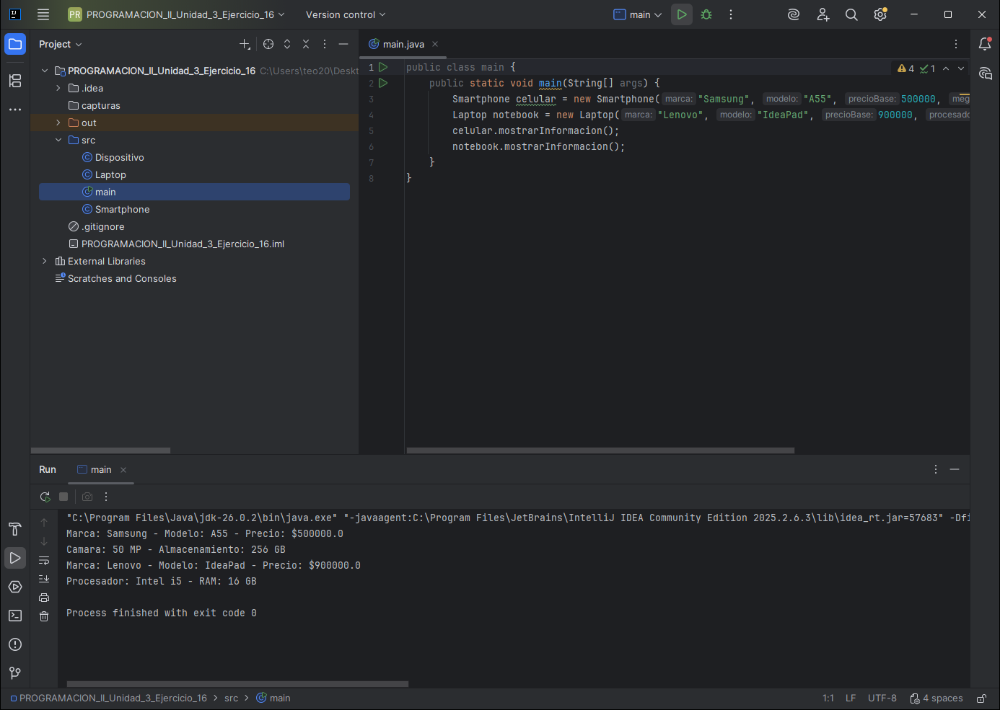

# PROGRAMACIÓN II — Unidad 3, Ejercicio 16: El Reproductor de Música y el Control de Pista Actual

Trabajo práctico de Programación II. Este repositorio contiene la resolución en Java del ejercicio 16 de la Unidad 3.

## Consigna

#### Contexto

En una aplicación de reproducción de audio, la lista de canciones y el índice de la pista en curso se encuentran protegidos para evitar saltos de índice fuera de los límites de la lista, lo que provocaría errores en tiempo de ejecución.

#### Consigna

Modelar una clase en Java que encapsule la lista de reproducción de un reproductor y controle la navegación entre pistas mediante métodos seguros.

#### Desarrollo requerido

- Crear la clase ListaReproduccion con atributos privados para el nombre de la lista y una colección privada de canciones, además de un índice entero que apunta a la pista actual.
- Desarrollar métodos públicos como siguiente() y anterior() que validen los límites del arreglo antes de desplazar el índice.
- Proveer un método obtenerPistaActual() que devuelva el nombre de la canción en curso sin exponer la colección interna.
- En el método main, inicializar la lista con canciones, simular la navegación hacia adelante y hacia atrás superando los límites, y mostrar la pista en reproducción por consola.

## Estructura del repositorio

```
PROGRAMACION_II_Unidad_3_Ejercicio_16/
├── README.md
├── capturas/
│   └── consola.png
└── src/
    ├── Dispositivo.java
    ├── Laptop.java
    ├── main.java   # clase con el método main
    └── Smartphone.java
```

## Funcionamiento y lógica

El ejercicio aplica **herencia y sobrescritura** para representar distintos dispositivos electrónicos de una tienda.

### `Dispositivo` (clase base)

Tiene los atributos `protected` `marca`, `modelo` y `precioBase`. Su método `mostrarInformacion()` imprime esos tres datos.

### `Smartphone`

Hereda de `Dispositivo` y agrega `megapixelesCamara` y `almacenamiento`. Sobrescribe `mostrarInformacion()`: primero llama a `super.mostrarInformacion()` para mostrar los datos comunes y después agrega la cámara y el almacenamiento.

### `Laptop`

Hereda de `Dispositivo` y agrega `procesador` y `memoriaRam`. Su `mostrarInformacion()` también reutiliza la versión de la clase base y le suma esos dos datos.

### `main`

Crea un **Samsung A55** ($500000, cámara de 50 MP y 256 GB) y una **Lenovo IdeaPad** ($900000, Intel i5 y 16 GB de RAM), y muestra la información de cada uno.

## Ejecución

Captura de la consola de IntelliJ IDEA ejecutando el programa:



Salida obtenida:

```
Marca: Samsung - Modelo: A55 - Precio: $500000.0
Camara: 50 MP - Almacenamiento: 256 GB
Marca: Lenovo - Modelo: IdeaPad - Precio: $900000.0
Procesador: Intel i5 - RAM: 16 GB
```
